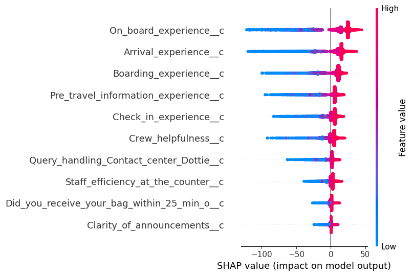
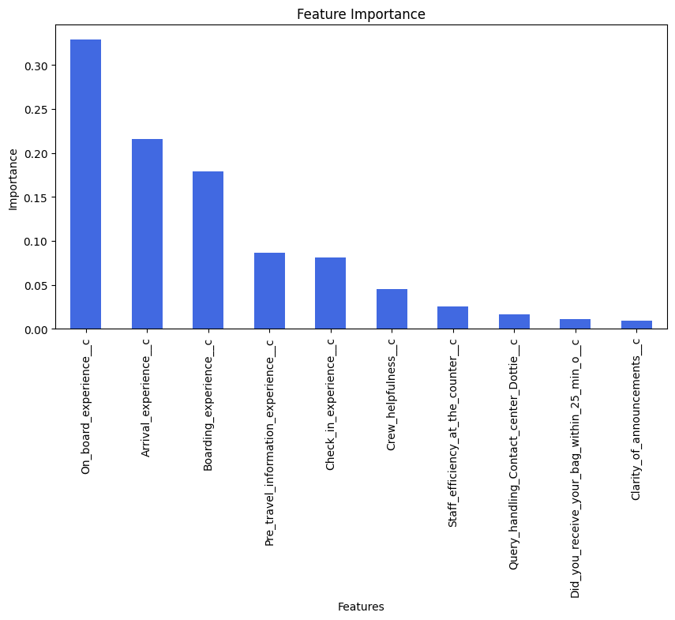
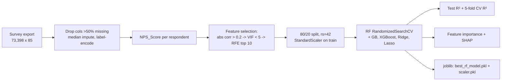
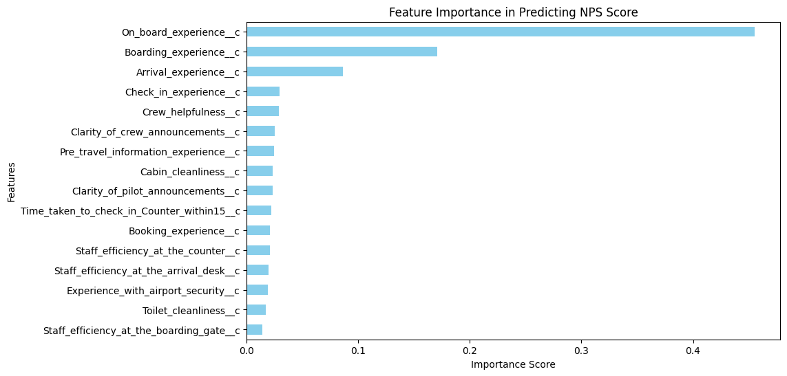

# NPS-Driven Strategy for Aviation

**Which airline service touchpoints actually move Net Promoter Score? Gradient-boosted and Random Forest models trained on 73,398 post-flight survey responses (test R² 0.718–0.725), with SHAP used to rank the journey stages.**

[](https://github.com/Akshatb848/NPS-Driven-Strategy-for-Aviation/actions/workflows/ci.yml)
[](LICENSE)
[](https://www.python.org/downloads/)


## Results at a glance

**Main pipeline.** The target is a per-respondent `NPS_Score` (+100 / 0 / −100). The test split is 20% of 73,398 rows.

| Model | Test R² | 5-fold CV mean R² (train split) |
|---|---|---|
| XGBoost | **0.7251** | 0.7271 |
| Gradient Boosting | 0.7250 | 0.7271 |
| Random Forest (tuned, saved in `best_rf_model.zip`) | 0.7179 | 0.7225 |
| Ridge Regression | 0.6337 | 0.6399 |
| Lasso Regression | 0.6337 | 0.6399 |

**Baseline.** The target is the binary `Promotors__c` flag from a separate `NPS.csv` export: XGBoost R² 0.6276 (RMSE 0.2832), Linear Regression R² 0.5297 (RMSE 0.3183).

All numbers come from the saved outputs of `NPS (1).ipynb`, and CI re-checks them against the notebook on every push.

<p align="center">
  
  
</p>

*Left: SHAP summary for the tuned Random Forest. Right: its impurity-based feature importances. Both figures are taken unchanged from the notebook outputs.*

**What the outputs say:**
- **The core flight stages drive NPS.** On-board, arrival and boarding experience carry most of the model's importance. On-board experience is also the top feature in the separate XGBoost baseline.
- **Bad experiences hurt more than good ones help.** Low on-board, arrival or boarding ratings can pull a prediction down by 100 points or more. High ratings add at most a few tens of points. Fixing poor experiences at these stages is likely to move NPS more than polishing stages that already score well.
- **Some touchpoints add little.** Announcement clarity, the baggage-within-25-minutes flag and contact-centre query handling contribute little once the main stages are known.

## Business problem

NPS sorts passengers into Promoters, Passives and Detractors, but the headline number does not say what to fix. The survey export used here holds ratings for 33 separate touchpoints across the journey. This project asks which touchpoints actually move a passenger's NPS outcome, so that improvement budgets go to the journey stages that matter most.

## Data

| | |
|---|---|
| Source | Private airline post-flight survey exports (Salesforce-style `*__c` columns) |
| Main file | 73,398 rows × 85 columns: 33 touchpoint rating columns on a 1–5 scale, NPS category flags, booking and flight metadata, passenger attributes |
| Baseline file | `NPS.csv`, a smaller export with 16 touchpoint ratings (row count not printed) |
| Licence and availability | **Not public and not included.** It contains personal passenger data (for example gender and date of birth), so it is not committed to this repository. Rerunning needs your own export with the same column names. The notebook's saved outputs show aggregates (`df.info()`, `describe()`, model scores, plots) plus ten rows of anonymous 1–5 ratings and predictions from the baseline test split. They contain no names, booking references or contact details. |

**How NPS is defined here.** For each row, `NPS_Score = (Promotors__c − Detractors__c) / (Promotors__c + Passive__c + Detractors__c) × 100`. With per-respondent 0/1 flags this gives +100 for a Promoter, 0 for a Passive and −100 for a Detractor. It is a per-passenger score, not an aggregate NPS.

## Approach



Recursive feature elimination (RFE) kept 10 touchpoints. In Random Forest importance order they are: on-board experience, arrival experience, boarding experience, pre-travel information, check-in experience, crew helpfulness, staff efficiency at the counter, contact-centre query handling, bag received within 25 minutes, and clarity of announcements.

<details>
<summary>Baseline: XGBoost feature importance on NPS.csv</summary>


</details>

## Reproduce

The notebook ran on Google Colab with Python 3.11. Python 3.11 is recommended, and CI installs `requirements.txt` on 3.11.

```bash
git clone https://github.com/Akshatb848/NPS-Driven-Strategy-for-Aviation.git
cd NPS-Driven-Strategy-for-Aviation
python3.11 -m venv .venv && source .venv/bin/activate   # Windows: .venv\Scripts\activate
pip install -r requirements.txt
jupyter notebook "NPS (1).ipynb"
```

1. Point `file_path` in cells 1–5 at your local CSV exports. The notebook currently uses Colab paths (`/content/...` and Google Drive).
2. Cells 1–4 are the `NPS.csv` baseline. Cell 5 is the main pipeline.
3. On scikit-learn 1.3 or later, change `'auto'` to `None` (or `1.0`) in `param_grid['max_features']`, or most of the search fits will fail (see Limitations).

Smoke checks (no data needed). These are the same checks CI runs:

```bash
pip install pytest nbformat
pytest -q tests
```

### Using the saved model

`best_rf_model.zip` contains `best_rf_model.pkl`, the tuned `RandomForestRegressor` (100 trees, `max_depth=30`, `min_samples_split=10`, `min_samples_leaf=4`, `max_features='sqrt'`, `bootstrap=False`, 10 inputs, about 49 MB unzipped), and `scaler.pkl`, the `StandardScaler`. Both were pickled with scikit-learn 1.6.1, which `requirements.txt` pins, and CI loads them on every push. Only unpickle files from sources you trust.

```python
import joblib
model, scaler = joblib.load("best_rf_model.pkl"), joblib.load("scaler.pkl")
# X_raw: (n, 10) touchpoint ratings in the same column order as `selected_feature_names` in the notebook
nps_pred = model.predict(scaler.transform(X_raw))   # per-respondent score, roughly -100..100
```

## Repository structure

```
.
├── NPS (1).ipynb             # baselines, main pipeline, model comparison, SHAP (with saved outputs)
├── best_rf_model.zip         # tuned Random Forest + StandardScaler (joblib)
├── docs/images/              # figures extracted from the notebook outputs
├── tests/test_notebooks.py   # CI smoke checks: nbformat validity + README numbers match notebook outputs
├── tests/test_saved_model.py # CI: the zipped model + scaler load, match the documented config, and predict
├── requirements.txt
├── .github/workflows/ci.yml
└── LICENSE
```

## Limitations

- **The data is private.** The notebook cannot be rerun without an export that uses the same schema.
- **Most of the hyperparameter search failed.** The grid includes `max_features='auto'`, which scikit-learn 1.3+ rejects. The notebook output shows "35 fits failed out of a total of 50", so only a few candidates were actually evaluated.
- **Preprocessing ran before the split.** Imputation, encoding, and the correlation, VIF and RFE selection all ran on the full dataset, so test scores may be slightly optimistic. The scaler was correctly fitted on the training split only.
- **A three-valued target is modelled as regression.** A Promoter / Passive / Detractor classifier reporting F1 and a confusion matrix would be the more natural framing.
- **Importance shows association, not causation.** Touchpoint ratings are correlated with one another. SHAP and impurity importance describe what the model relies on, not what causes satisfaction.
- **The saved Random Forest is not the top model.** XGBoost and Gradient Boosting score about 0.007 R² higher.

## Next steps

1. Move imputation, encoding and feature selection into a scikit-learn `Pipeline` that is fitted inside cross-validation.
2. Recast the problem as 3-class classification (or ordinal regression), report macro-F1, and calibrate the outputs to an aggregate NPS per route or month.
3. Fix the search grid and tune XGBoost or LightGBM, then save the best model as a versioned artefact with its feature order.
4. Turn the SHAP results into a driver dashboard: the expected NPS gain from moving each touchpoint's low ratings up by one point.
5. Validate the drivers over time, for example by checking whether they hold on a later month's data.

## License

Code: [MIT](LICENSE) © 2026 Akshat Banga. The survey data is proprietary and not included.

## Author

**Akshat Banga**, AI Generalist and AI transformation. [GitHub](https://github.com/Akshatb848) · [LinkedIn](https://www.linkedin.com/in/akshat-banga-6574aa170/)
